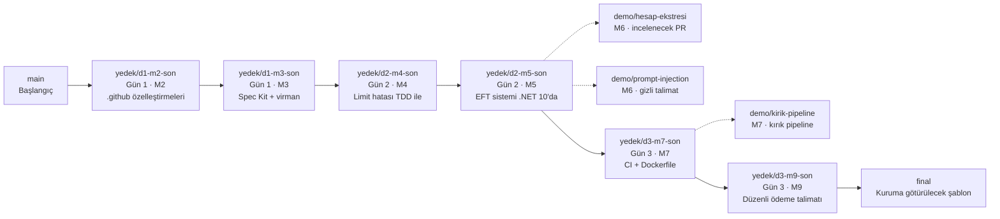

# Erdağı Bank — GitHub Copilot ile Yazılım Geliştirme

Türkiye Bankalar Birliği **"GitHub Copilot ile Yazılım Geliştirme"** eğitiminin (3–5 Kasım 2026, her gün 09:30–12:30) demo deposu.
Eğitmen: Dr. Ertürk Erdağı · [linkedin.com/in/erturkerdagi](https://www.linkedin.com/in/erturkerdagi)

> Bu depodaki bütün müşteri adları, TCKN'ler, IBAN'lar, şifreler ve tutarlar **uydurmadır**.
> Kodda bazı hatalar ve güvenlik açıkları eğitim amacıyla **bilerek** bırakılmıştır. Üretimde kullanmayın.

## Başlamadan önce

| Dosya | Ne zaman |
| --- | --- |
| [rehber/00-HAZIRLIK.md](rehber/00-HAZIRLIK.md) | **Eğitimden önce.** VS Code, .NET 10, Git, GitHub Copilot, Spec Kit kurulumu ve kontrol listesi |
| [rehber/GUN1-DEMOLAR.md](rehber/GUN1-DEMOLAR.md) · [GUN2](rehber/GUN2-DEMOLAR.md) · [GUN3](rehber/GUN3-DEMOLAR.md) | Eğitim sırasında ya da sonrasında, demoları kendi başınıza adım adım yapmak için |
| [docs/PROMPTLAR-GUN1.md](docs/PROMPTLAR-GUN1.md) · [GUN2](docs/PROMPTLAR-GUN2.md) · [GUN3](docs/PROMPTLAR-GUN3.md) | Demolarda yazılan bütün prompt'lar ve terminal komutları, kullanım sırasıyla; kopyala-yapıştır için |

## Banka senaryomuz

Üç gün boyunca tek bir kurgusal banka üzerinde çalışıyoruz: **Erdağı Bank**. Siz bu bankanın Dijital Bankacılık ekibisiniz ve GitHub Copilot pilotunu yürütüyorsunuz. Pilotun sonunda yönetim kuruluna tek bir soru gidecek: *"Copilot'u bütün bankaya yayalım mı?"* Üç gün boyunca yaptığımız her şey bu sorunun kanıtı.

Ekip iki sistemle çalışıyor:

| Sistem | Klasör | Teknoloji |
| --- | --- | --- |
| Hesap API'si (mobil uygulamanın arka ucu): hesap sorgulama, işlem geçmişi, transfer | `src/Bank.Api` | .NET 10, ASP.NET Core Minimal API, EF Core, SQLite |
| EFT ücret hesaplama ve talimat işleme (2014'ten kalma, belgesiz) | `legacy/` | .NET Framework 4.8, eski tip proje dosyası |

## Üç günde ne yapacağız?

| Gün | Soru | Banka senaryomuzda yapacağımız iş | Gün sonunda elimizde |
| --- | --- | --- | --- |
| **Gün 1** · 3 Kasım | "Copilot geldi, şimdi ne yapıyoruz?" | **M1** Copilot'un çalışma biçimi, Ask/Plan/Agent modları, çıktı doğrulama · **M2** Bankanın kodlama kurallarını Copilot'a öğreten dosyalar (talimat, prompt, skill, ajan) · **M3** İş biriminin "kendi hesaplarım arasında para aktarayım" talebini Spec Kit ile geliştirme | `.github/` altında kurumsal özelleştirme dosyaları · spec'i, planı ve testleriyle **virman** özelliği (`yedek/d1-m3-son`) |
| **Gün 2** · 4 Kasım | "Hızlandık, peki doğru mu?" | **M4** Müşterinin şikâyet ettiği günlük limit hatasını test odaklı düzeltme · **M5** 2014 EFT sistemini ücretleri koruyarak .NET 10'a taşıma · **M6** Dış ekipten gelen beş açıklı PR'ı ve prompt injection'ı inceleme | Düzeltilmiş limit kuralı ve testleri · .NET 10'da çalışan EFT sistemi (`yedek/d2-m5-son`) · güvenlik bulguları |
| **Gün 3** · 5 Kasım | "Pilottan kuruma nasıl geçeriz?" | **M7** CI workflow, Dockerfile ve kırık pipeline teşhisi · **M8** Veri, maliyet, politika ve ölçüm · **M9** Atölye: "düzenli ödeme talimatı" özelliğini issue'dan birleştirmeye uçtan uca geliştirme | CI/CD (`yedek/d3-m7-son`) · uçtan uca yeni özellik (`yedek/d3-m9-son`) · kuruma götürülecek şablon (`final`) |

## Neredeyiz? Branch haritası

Her modülün bitmiş hali bir **yedek branch**'te durur. Eğitimde geride kalırsanız bir sonraki modüle buradan katılırsınız.



| Branch | İçerik | Test sayısı |
| --- | --- | --- |
| `main` | Eğitimin başlangıç noktası: Hesap API + 2014 EFT sistemi | |
| `yedek/d1-m2-son` | Gün 1 · M2 sonu: `.github/` altında talimat, prompt, skill ve ajan dosyaları, para yatırma ucu | 16 |
| `yedek/d1-m3-son` | Gün 1 · M3 sonu: Spec Kit kurulumu, anayasa, `specs/001-...` ve kendi hesaplar arası virman | 26 |
| `yedek/d2-m4-son` | Gün 2 · M4 sonu: günlük limit hatası ve gece yarısı hatası test odaklı düzeltildi | 33 |
| `yedek/d2-m5-son` | Gün 2 · M5 sonu: EFT sistemi karakterizasyon testleriyle kilitlendi ve .NET 10'a taşındı | 33 + 16 |
| `demo/hesap-ekstresi` | Gün 2 · M6: güvenlik incelemesi yapılacak, bilerek açık bırakılmış PR | |
| `demo/prompt-injection` | Gün 2 · M6: içine gizli talimat yerleştirilmiş doküman | |
| `yedek/d3-m7-son` | Gün 3 · M7 sonu: GitHub Actions CI ve Dockerfile | 33 + 16 |
| `demo/kirik-pipeline` | Gün 3 · M7: bilerek kırılmış pipeline (`global.json`) | |
| `yedek/d3-m9-son` | Gün 3 · atölye sonu: düzenli ödeme talimatı | 52 + 16 |
| `final` | Kurumunuza götürebileceğiniz şablon: bütün talimat, prompt, ajan ve skill dosyaları | 52 + 16 |

Bir yedek branch'ten devam etmek için:

```powershell
git fetch --all
git switch yedek/d1-m3-son            # sadece bakmak için
git switch -c benim-calismam yedek/d1-m3-son   # üzerinde çalışmak için
```

## Hangi dosya ne işe yarıyor?

### Hesap API'si — `src/Bank.Api`

| Yol | Ne işe yarar |
| --- | --- |
| `Program.cs` | Uygulamanın girişi: servis kayıtları, endpoint'lerin eklenmesi, veritabanının hazırlanması |
| `Domain/` | Varlıklar: `Customer`, `Account`, `Transfer` |
| `Services/TransferService.cs` | Transfer iş kuralları: bakiye, günlük limit, transfer kaydı |
| `Services/TransferLimitChecker.cs` | Günlük limit kontrolü; **Gün 2'de düzelteceğimiz hata burada** |
| `Services/AccountService.cs` | Hesap sorgulama |
| `Services/TransferErrors.cs` | İş hatalarının kodları (`transfer.daily_limit_exceeded` gibi) |
| `Common/Result.cs` | Hataları exception yerine dönüş değeriyle taşıyan `Result<T>` tipi |
| `Endpoints/` | HTTP uçları; `ResultHttpExtensions.cs` iş hatalarını ProblemDetails yanıtına çevirir |
| `Contracts/` | İstek ve yanıt modelleri (record'lar) |
| `Data/` | EF Core `BankDbContext`, depolar (repository) ve `SeedData.cs`'teki örnek müşteriler |
| `Bank.Api.http` | API'ye örnek HTTP istekleri; VS Code'da REST Client eklentisiyle "Send Request" |

Örnek veriler: Ayşe Yılmaz (hesap 1: 25.000 TL, hesap 2: 100.000 TL, günlük limit 10.000 TL), Mehmet Demir (hesap 3: 5.000 TL), Zeynep Kaya (hesap 4: TRY, hesap 5: EUR). Veritabanı (`erdagibank.db`) her açılışta silinip yeniden oluşturulur; her demo aynı verilerle başlar.

### Testler — `tests/Bank.Api.Tests`

xUnit testleri. `Fakes/` klasöründe veritabanı yerine kullanılan bellek içi sahte sınıflar var. Çalıştırmak için: `dotnet test ErdagiBank.slnx`.

### 2014 EFT sistemi — `legacy/`

| Yol | Ne işe yarar |
| --- | --- |
| `EB.Legacy.Transfer/EftUcretHesaplayici.cs` | EFT ücret hesabı; `double` ve yuvarlama tuhaflıkları burada |
| `EB.Legacy.Transfer/TalimatIsleyici.cs` | Talimatları işler; konsola kişisel veri yazar, `DateTime.Now` kullanır |
| `EB.Legacy.Transfer/EftTalimatRepository.cs` | Veritabanı erişimi; string birleştirmeli SQL |
| `EB.Legacy.Transfer/Ayarlar.cs`, `JsonYardimci.cs` | `ConfigurationManager` ve `JavaScriptSerializer`; .NET 10'a geçişi zorlaştıran parçalar |
| `EB.Legacy.Transfer.Host/` | Konsol programı ve `App.config` (düz metin şifre içerir), `ornek-talimatlar.json` |
| `EB.Legacy.Transfer.Tests/` | Karakterizasyon testleri; Gün 2'de genişletiyoruz |

### Copilot özelleştirmeleri — `.github/` (Gün 1 · M2 ve sonrası)

| Yol | Ne işe yarar |
| --- | --- |
| `copilot-instructions.md` | Depo genelindeki kurallar; Copilot her prompt'a otomatik ekler |
| `instructions/*.instructions.md` | Belirli dosyalar için kurallar (`applyTo` ile): API uçları, testler, workflow'lar |
| `prompts/*.prompt.md` | Tekrar eden görevlerin tarifi; sohbette `/yeni-endpoint`, `/guvenlik-incele`, `/pr-aciklamasi` ile çağrılır |
| `skills/banka-api-standartlari/` | Skill: konu geldiğinde Copilot'un kendisi yüklediği talimat ve şablon paketi |
| `skills/speckit-*/` | Spec Kit komutları (`/speckit-specify` vb.), Gün 1 · M3'te `specify init` ile gelir |
| `agents/guvenlik-inceleyici.agent.md` | Yalnızca okuyabilen güvenlik inceleme ajanı |
| `agents/teknik-lider.agent.md` | Değişiklikleri spec'e göre inceleyen ajan (Gün 3) |
| `workflows/ci.yml` | GitHub Actions CI (Gün 3 · M7) |

### Spec Kit — `.specify/` ve `specs/` (Gün 1 · M3 ve sonrası)

| Yol | Ne işe yarar |
| --- | --- |
| `.specify/memory/constitution.md` | Anayasa: projenin değişmez ilkeleri |
| `.specify/templates/` | Spec, plan ve görev şablonları |
| `.specify/scripts/powershell/` | Spec Kit'in yardımcı betikleri; ajan bunları çalıştırmak için izin ister |
| `specs/001-kendi-hesaplar-arasi-virman/` | Gün 1 özelliği: `spec.md`, `plan.md`, `tasks.md`, `contracts/` |
| `specs/002-duzenli-odeme-talimati/` | Gün 3 atölye özelliği |

### Diğer

| Yol | Ne işe yarar |
| --- | --- |
| `ErdagiBank.slnx` | Çözüm dosyası (yeni XML biçimi) |
| `global.json` | Kullanılacak .NET SDK sürümü |
| `Dockerfile`, `.dockerignore` | Container image'ı (Gün 3 · M7) |
| `docs/` | Demo prompt'ları ve komutları |
| `rehber/` | Kurulum ve adım adım demo rehberleri |

## Hızlı başlangıç

Kurulum ayrıntıları için [rehber/00-HAZIRLIK.md](rehber/00-HAZIRLIK.md).

```powershell
cd C:\egitim
git clone https://github.com/erturkerdagi/tbb-copilot-egitimi.git
cd tbb-copilot-egitimi
dotnet build ErdagiBank.slnx
dotnet test ErdagiBank.slnx
dotnet run --project src/Bank.Api
```

API `http://localhost:5080` adresinde açılır. Örnek istekler `src/Bank.Api/Bank.Api.http` dosyasında.

> Depoyu Google Drive, OneDrive ya da Dropbox gibi **senkronize edilen bir klasöre koymayın**. Senkronizasyon `.git` klasöründeki dosyaları kilitleyip git komutlarını bozabiliyor (`index.lock: File exists`).
