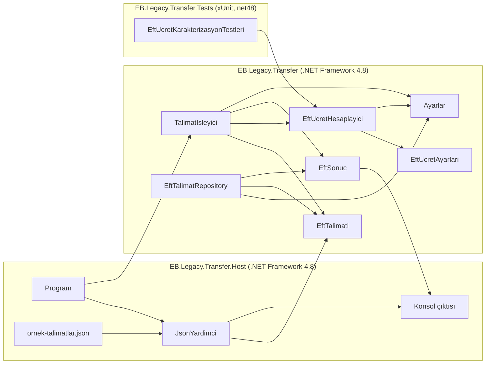

# EB.Legacy Çözümü Analizi

## Mimari Özet

`EB.Legacy.sln` üç projeden oluşur:

| Proje | Hedef / rol |
| --- | --- |
| `EB.Legacy.Transfer` | .NET Framework 4.8 sınıf kütüphanesi; EFT talimatı, sonuç, ücret hesabı, işleme ve SQL repository kodu |
| `EB.Legacy.Transfer.Host` | .NET Framework 4.8 konsol uygulaması; JSON dosyasından talimatları alır, kütüphaneyi çağırır ve sonuçları konsola yazar |
| `EB.Legacy.Transfer.Tests` | `net48` xUnit test projesi; kütüphaneye referans verir |

Host ve test projeleri `EB.Legacy.Transfer` kütüphanesine doğrudan proje referansı verir. Ana proje dosyaları klasik, SDK dışı MSBuild biçimindedir; test projesi SDK biçimini kullanır.

Çalışan konsol akışı `Program` ile başlar. Program, komut satırında verilen dosyayı veya varsayılan `ornek-talimatlar.json` dosyasını `JsonYardimci` ile okur. JSON kayıtları `EftTalimati` nesnelerine dönüştürülür ve `TalimatIsleyici.Isle` metoduna verilir. İşleyici gönderen IBAN için temel biçim kontrolü yapar, `EftUcretHesaplayici` ile ücreti hesaplar, mesai/hafta sonu durumunu belirler ve `EftSonuc` üretir. Host sonuçları tablo ve JSON biçiminde konsola basar.

`EftTalimatRepository`, talimatları SQL Server'dan okuyup sonuçları kaydetmek için kütüphanede yer alır; ancak mevcut konsol host akışında kullanılmaz. Veritabanı bağlantı cümlesi ve ücret/mesai ayarları host'un `App.config` dosyasından, `Ayarlar` sınıfı aracılığıyla `ConfigurationManager` üzerinden okunur. JSON işlemlerinde `JavaScriptSerializer`, SQL işlemlerinde `System.Data.SqlClient` kullanılır.

## Sınıflar Arası İlişki ve Veri Akışı

## Modern .NET'e Geçişi Zorlaştıran Noktalar

- **Eski proje biçimi ve .NET Framework hedefi:** Kütüphane ile host klasik `.csproj` biçiminde ve `v4.8` hedefli. SDK tarzı projeye ve modern .NET hedefine geçerken framework referansları, derleme ayarları ve yapılandırma davranışı taşınmalıdır.
- **Framework'e bağlı API'ler:** `ConfigurationManager`, `System.Web.Extensions` içindeki `JavaScriptSerializer` ve `System.Data.SqlClient` mevcut koda bağlılık oluşturur; hedef framework'e göre yapılandırma, JSON ve SQL istemcisi seçenekleri değerlendirilmelidir.
- **Yapılandırmanın host'a bağlı olması:** Kütüphane ayarları statik `Ayarlar` sınıfından süreç yapılandırmasını okur. `App.config` host projesindedir; kütüphaneyi başka bir host veya test bağlamında çalıştırırken ayar kaynağı önem kazanır.
- **Somut ve senkron bağımlılıklar:** İşleyici doğrudan sistem saatini ve konsolu kullanır; repository doğrudan SQL bağlantısı açar. Bu yapı test edilebilirliği, asenkron veri erişimini ve uygulama sınırlarının ayrılmasını zorlaştırır.
- **Sınırlı karakterizasyon testleri:** Mevcut test, ücret hesabında tek bir senaryoyu kapsar. Taşıma sırasında davranışın değişmediğini doğrulamak için ücret eşikleri, kanallar ve işleyici akışı daha geniş biçimde test edilmelidir.

## Güvenlik ve Kalite Riskleri

1. **Yüksek - Yapılandırmada düz metin veritabanı kimlik bilgisi:** `EB.Legacy.Transfer.Host/App.config` içinde kullanıcı adı ve parola içeren bir SQL Server bağlantı cümlesi bulunuyor. Gerçek ortam kimlik bilgilerinin kaynak kontrolüne girmesi erişim ihlaline yol açabilir. Değerler burada tekrar edilmemiştir.
2. **Yüksek - SQL injection:** `EftTalimatRepository`, `iban`, talimat sonucu alanları ve mesajı SQL ifadelerine string birleştirmeyle ekliyor. Sorgular parametreli komutlara dönüştürülmelidir.
3. **Yüksek - Kişisel verilerin konsola ve hata mesajına yazılması:** `TalimatIsleyici`, alıcı adı ile tam alıcı IBAN'ını konsola basıyor; geçersiz gönderen IBAN'ını da hata mesajına ekliyor. Konsol çıktısı log olarak saklanır veya paylaşılırsa kişisel veri açığa çıkabilir.
4. **Yüksek - Ücret hesabında kayan noktalı türler:** `EftUcretHesaplayici` ve `EftUcretAyarlari`, ücret hesaplamasının ara değerleri/oranları için `double` kullanıyor. Para hesabında `decimal` dışındaki türler yuvarlama ve kuruş farklarına yol açabilir.
5. **Orta - Geniş kapsamlı exception yakalama ve mesajı dışarı aktarma:** İşleyici tüm exception'ları yakalayıp `ex.Message` değerini sonuç nesnesine koyuyor. Beklenmeyen iç hata ayrıntıları kullanıcıya/çıktıya taşınabilir; hata türleri ve dışarı verilecek mesajlar sınırlandırılmamış.
6. **Orta - Eksik girdi doğrulaması:** Gönderen IBAN için yalnızca uzunluk ve `TR` öneki kontrol ediliyor. Alıcı IBAN, kanal, boş/null talimat listesi ve alan tutarlılığı için aynı seviyede doğrulama görünmüyor.
7. **Orta - Hatalı ücret yapılandırmasının sessizce varsayılana düşmesi:** `Ayarlar` ücret ayarlarını okurken parse hatalarını yakalıyor ve yok sayıyor; sistem geçersiz ayarla sessizce varsayılan tarifeyi kullanabilir.
8. **Orta - Zaman tutarlılığı ve test edilebilirlik:** `TalimatIsleyici` `DateTime.Now` değerini farklı noktalarda tekrar okuyor. Mesai sınırında zaman damgası ile durum hesabı farklı anlara dayanabilir; saat dilimi açıkça tanımlanmamış ve zaman bağımlılığı testlerde enjekte edilemiyor.
9. **Orta - Test kapsamı davranış koruması için yetersiz:** `EftUcretKarakterizasyonTestleri` tek ücret senaryosuyla sınırlı. Ücret eşikleri, tüm kanallar, geçersiz girişler ve mesai dışı durumlar için karakterizasyon testleri görünmüyor.

## İnceleme Sınırı

Bu belge proje dosyaları ve kaynak kodunun statik incelenmesine dayanır. Çözüm veya testler bu analiz sırasında çalıştırılmamıştır. `EftTalimatRepository` kodu incelenmiştir; mevcut host akışında çağrıldığı görülmemiştir.